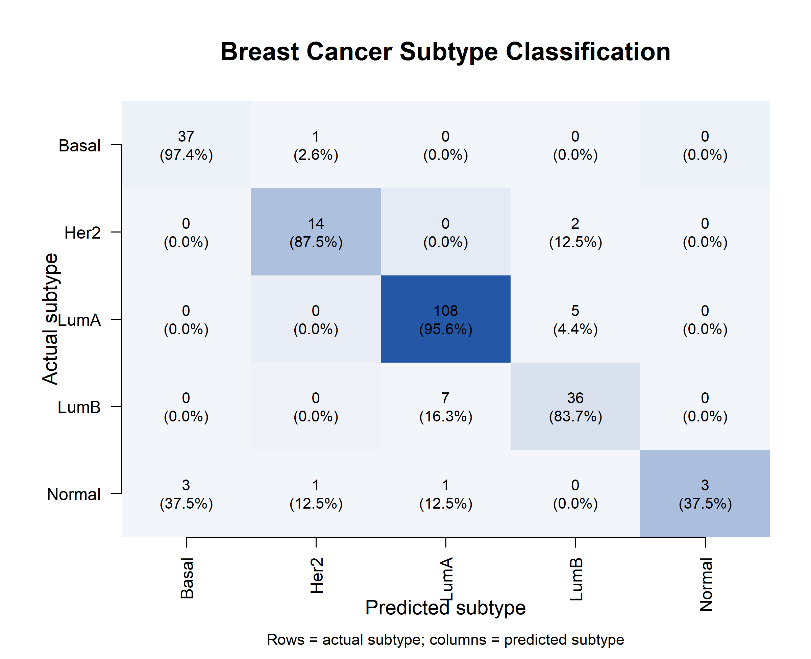
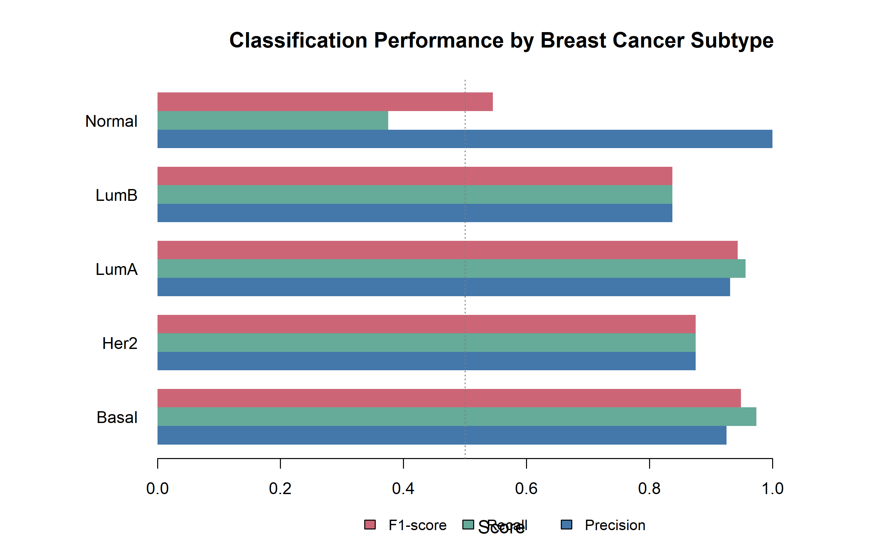
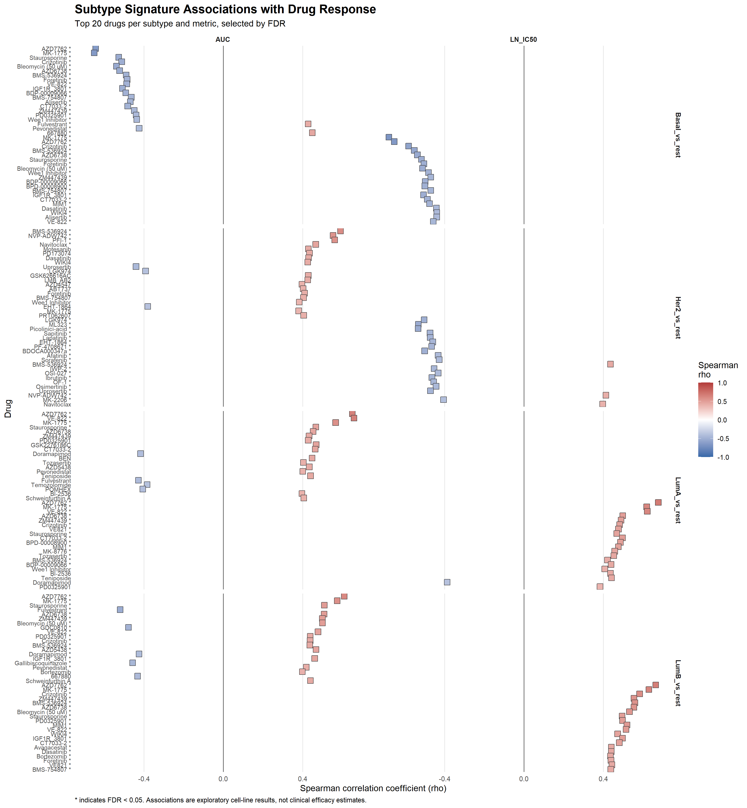

# From Cancer Transcriptomics to AI-Guided Drug Prioritization

An integrative computational biology project combining breast cancer transcriptomics, machine-learning classification, molecular expression signatures, and exploratory drug prioritisation using public datasets.

**Author:** Kazhal Ghiasi

## Overview

Breast cancer comprises molecularly distinct subtypes with different transcriptional profiles and biological characteristics. Identifying these patterns can help investigate subtype-associated genes, evaluate machine-learning approaches to molecular classification, and explore hypotheses for therapeutic prioritisation.

This project integrates differential gene-expression analysis, multinomial LASSO classification, subtype-signature analysis, and drug-response association testing in an R-based workflow.

The central objective is to investigate how molecular subtype information and alternative expression signatures influence computational drug prioritisation, and how robust these rankings remain under different analytical assumptions.

## Research objectives

1. Identify genes differentially expressed between matched breast tumour and normal tissue samples.
2. Evaluate machine-learning classification of breast cancer molecular subtypes using gene-expression data.
3. Construct and evaluate subtype-associated expression signatures.
4. Investigate associations between expression-derived scores and experimental drug-response measurements.
5. Assess the robustness of drug prioritisation across response metrics, cell-line sources, and analytical thresholds.

## Data sources

| Resource | Role in the project |
|---|---|
| [TCGA-BRCA](https://portal.gdc.cancer.gov/projects/TCGA-BRCA) | Breast cancer transcriptomic data and matched tumour–normal analysis |
| PAM50 subtype annotations | Molecular subtype labels for classification and signature analyses |
| [Genomics of Drug Sensitivity in Cancer (GDSC)](https://www.cancerrxgene.org/) | Experimental cell-line drug-response data for exploratory association analysis |

The project uses public datasets and derived analysis files. Data accessions, source publications, preprocessing decisions, and required inputs should be documented alongside the relevant scripts.

## Analytical workflow

### 1. Paired differential gene-expression analysis

Matched tumour–normal samples are analysed using DESeq2 with the design:

`~ patient + condition`

This design accounts for patient-specific differences when estimating condition-associated expression changes. The paired analysis uses 113 matched tumour–normal patient pairs.

### 2. Machine-learning subtype classification

A multinomial LASSO model implemented with `glmnet` classifies breast cancer samples into annotated molecular subtypes using gene-expression features.

The corrected benchmark uses:

- 1,095 samples with known subtype labels.
- A stratified split of 877 training samples and 218 held-out test samples.
- Five-fold cross-validation within the training cohort.
- Selection of the 1,000 most variable genes separately within each cross-validation training fold.
- Selection of the final gene set using the complete training cohort.
- Evaluation on the held-out test set using accuracy, balanced accuracy, macro F1, confusion matrices, and subtype-level metrics.

Feature selection is performed within each cross-validation fold to prevent the corresponding validation samples from influencing gene selection. The held-out test set is kept separate from model tuning.

### 3. Subtype-associated expression signatures

Expression signatures are constructed and evaluated to investigate molecular differences between breast cancer subtypes. Additional analyses examine how signature-scoring choices influence downstream associations and prioritisation results.

### 4. Drug-response association and prioritisation

Subtype-associated expression scores are compared with GDSC2 cell-line drug-response measurements to explore candidate drug prioritisation across molecular subtypes.

These analyses investigate associations between expression-derived scores and experimental response measurements. They are exploratory and do not establish causal mechanisms, clinical treatment efficacy, or individual patient drug-response predictions.

### 5. Robustness and sensitivity analyses

The project evaluates whether drug-prioritisation results remain consistent under different analytical assumptions, including:

- Minimum cell-line coverage thresholds.
- Alternative response metrics, including AUC and LN_IC50.
- Restriction to Broad-source cell lines.
- Alternative scoring and effect-size robustness analyses.

Ranking correlations, top-ranked candidate overlap, effect sizes, and direction concordance are used to assess the stability of the findings.

## Machine-learning benchmark results

The corrected multinomial LASSO model produced the following held-out test results:

| Metric | Result |
|---|---:|
| Training samples | 877 |
| Held-out test samples | 218 |
| Selected genes | 1,000 |
| Accuracy | 90.83% |
| Balanced accuracy | 80.33% |
| Macro F1 | 0.830 |

Performance varied by subtype. Basal and Luminal A samples were classified relatively consistently, while Normal-like classification was more challenging: recall was 37.5% among the eight Normal-like test samples.

These results describe the current benchmark on the specified split. They should be interpreted alongside the confusion matrix, class-level metrics, and class sizes.

## Reproducibility

The repository contains numbered R scripts documenting the project's analytical workflow. Scripts use saved intermediate objects and derived files to avoid unnecessary repetition of computationally expensive steps.

For reproducibility, the repository should include:

- Analysis scripts and their required inputs.
- Data-source documentation and preprocessing decisions.
- Selected result tables and figures.
- Model evaluation and robustness summaries.
- R and package-version information.

Large raw datasets and temporary intermediate files are not required to be committed to GitHub. Users should obtain source data from their official repositories and follow the documented execution order.

## Results and figures

The selected outputs are organised in the `results/` directory.

### Machine-learning performance

### Drug-response association landscape

### Downloadable result tables

- [GDSC2 subtype–drug associations](results/gdsc2_subtype_drug_associations.csv)
- [Drug-ranking robustness across coverage thresholds](results/gdsc2_drug_ranking_robustness.csv)
- [Agreement between LN_IC50- and AUC-based rankings](results/robustness_LNIC50_vs_AUC_rank_agreement.csv)
- [Broad-source-only robustness summary](results/broad_only_robustness_summary.csv)
- [Broad-source-only effect-size robustness](results/broad_only_effect_size_robustness.csv)
- [Subtype-signature effect-filter summary](results/subtype_signature_effect_filter_summary.csv)
- [Subtype-signature threshold sensitivity](results/subtype_signature_threshold_sensitivity.csv)
- [Top 200 signature genes per subtype](results/subtype_signatures_top200_per_subtype.csv)
- [Cross-validation-safe benchmark metrics](results/ml_subtype_cv_safe_benchmark_metrics.csv)
- [Cross-validation-safe class-level metrics](results/ml_subtype_cv_safe_class_metrics.csv)
- [Cross-validation-safe confusion matrix](results/ml_subtype_cv_safe_confusion_matrix.csv)
- [Cross-validation-safe held-out predictions](results/ml_subtype_cv_safe_predictions.csv)
- [Genes selected by the cross-validation-safe benchmark](results/ml_subtype_cv_safe_selected_genes.csv)

See [results/README.md](results/README.md) for the results-directory inventory.

## Limitations

- Transcriptomic profiles from tumour tissue and drug-response measurements from cell lines represent different experimental settings.
- Expression–response associations do not establish causality.
- Cell-line results cannot be directly interpreted as clinical treatment recommendations.
- Classification performance depends on subtype labels, the evaluation cohort, and the modelling procedure.
- Drug prioritisation is sensitive to data coverage, response metrics, and analytical assumptions.
- Computationally prioritised candidates require independent validation before biological or therapeutic conclusions can be established.

## Technologies

- **R and RStudio** — analysis and workflow development.
- **DESeq2** — differential gene-expression analysis.
- **glmnet** — regularised multinomial classification.
- **Bioconductor** — transcriptomic data analysis.
- **TCGA-BRCA, PAM50 annotations, and GDSC2** — molecular and drug-response data.
- **Statistical evaluation and sensitivity analysis** — classification performance, ranking stability, and robustness.

## Project status

The 13-script analysis pipeline has been reviewed, and the corrected machine-learning benchmark has been run successfully. Repository documentation, selected result files, figures, and reproducibility metadata are being consolidated for publication.

## Scope

This is an exploratory computational biology project integrating cancer transcriptomics, machine learning, and expression-informed drug prioritisation. It aims to investigate molecular patterns and the robustness of computational findings, rather than provide clinical decision support.

## Author

**Kazhal Ghiasi**
